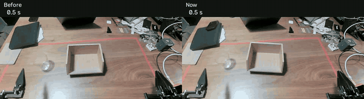
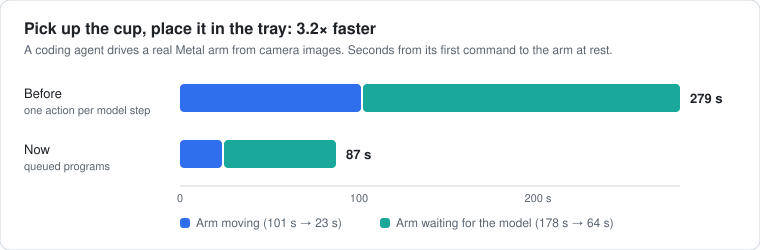

# makermods-llm-harness

Let a coding agent drive a MakerMods arm (Metal or Maker), on real hardware or in a simulator.

This is **agent as policy**, not code as policy. The agent does not write one program up front and hope it works.
It looks through the cameras, moves, reads what happened and decides again, the whole way through the task. The
harness makes that loop safe (every motion is checked against the table, keep-out zones and joint limits) and fast
(the arm keeps moving while the model thinks).

## Speed

"Pick up the plastic cup and place it in the wooden tray", on a real Metal arm, driven by a coding agent
(Codex, GPT-6.2 Astra) from the camera images. Before on the left, now on the right, played at 8× speed:



| | Before | Now | |
|---|---|---|---|
| Total | 279 s | 87 s | **3.2× faster** |
| Arm moving | 101 s | 23 s | 4.3× |
| Arm waiting for the model | 178 s | 64 s | 2.8× |
| Requests from the model | 28 | 10 | |



One run each. The cup ended in the tray both times.

What changed:

- **Programs, not single actions.** The agent runs Python in a kernel that stays alive (`llm-harness py`), so one
  step does many moves.
- **Pipelining.** `kernel.queue(fn)` returns at once. The arm runs the action while the agent writes the next one.
- **Check a whole plan in one call.** `r.reachable([...])` replaces trial and rejection.
- **Move until contact.** `until="contact"` replaces stepping down a centimetre at a time.
- **Speed limits you set per robot.** The run above used 80 deg/s (30 near the table) in place of 20 (5).
- **A home pose that looks at the table.** `home:` in the robot file sets where `home` goes. The run above used
  30 cm up with the wrist camera pointing 60 degrees down, so the first picture already shows the scene.

These ideas come from [making-rua-fast](https://github.com/fast-rua/making-rua-fast) (Apache-2.0), the code behind
"Getting Robot-Use Agents to Run in Real Time". This harness is a separate implementation of them for the MakerMods
arms.

## Install

Python 3.10 or newer. The arm SDKs ([metal-arm](https://github.com/makermods-robotics/metal-arm-sdk),
[maker-arm](https://github.com/makermods-robotics/maker-arm-sdk)) are installed with it.

```bash
pip install "makermods-llm-harness[mujoco,mcp,agent] @ git+https://github.com/makermods-robotics/makermods-llm-harness"
```

## Try it in the simulator

```bash
llm-harness sim                  # terminal 1: a simulated Metal arm (--arm maker, --mujoco)
```

```bash
llm-harness py <<'PY'            # terminal 2
print(r.look())                  # one image of every camera
def reach(r):
    r.home()
    r.move([0.31, 0.03, 0.54], pitch=-5)
kernel.queue(reach)
PY
llm-harness py --wait 30         # the action's report: how it ended, the arm, a camera image
llm-harness op quit
```

One action at a time works too: `llm-harness op home`, `llm-harness op nudge 0 0 -0.05`, `llm-harness op stop`.

## On a real arm

Set the arm up with its SDK first (`metal-arm rig init --detect`, `metal-arm scan`). Then:

```bash
llm-harness robot init bench --arm metal --from-rig --arms left --cameras top left_wrist
llm-harness robot check bench        # read-only: joints, temperatures, one image per camera
llm-harness calibrate --robot bench  # touch the table, then record the folded rest pose
llm-harness serve --robot bench      # Ctrl-C or `llm-harness op quit` rests the arm and ends it
```

Keep a hand on the power switch. The harness checks every motion, but it does not see people.

## Connect an agent

| Way | Command |
|---|---|
| A coding agent (Claude Code, Codex) runs the CLI | `llm-harness py` and `llm-harness op` against `llm-harness serve` |
| MCP tools | `llm-harness mcp --connect` |
| Built-in model loop | `llm-harness run "pick up the red cube" --sim` |

Point the agent at [docs/AGENT_GUIDE.md](docs/AGENT_GUIDE.md). `llm-harness py` runs the agent's code as your user,
without a sandbox, and works on Linux and macOS.

## Docs

| | |
|---|---|
| [docs/AGENT_GUIDE.md](docs/AGENT_GUIDE.md) | Driving the arm from the kernel: look, check, queue, read the report |
| [docs/OPERATING.md](docs/OPERATING.md) | The operator's side: calibration, stopping, what each result means |
| [docs/REFERENCE.md](docs/REFERENCE.md) | Every command and action, the safety model, two arms, the Python API |
| [docs/backends.md](docs/backends.md) | The simulators, and plugging in your own |

## Development

```bash
uv venv --python 3.12
uv pip install -e ".[dev,mujoco,mcp,agent]"
.venv/bin/python -m pytest -q
```

Tests run on the simulators only; none opens a device.

Apache-2.0 ([LICENSE](LICENSE), [NOTICE](NOTICE)).
